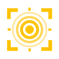
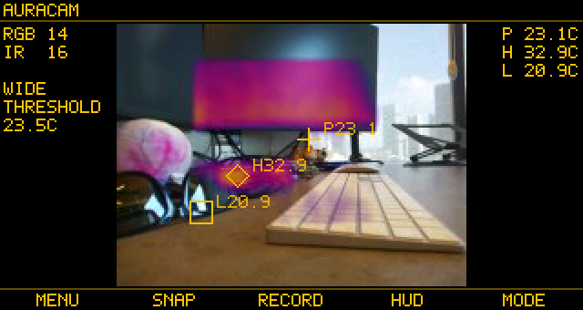

<p align="center">
  
</p>

# AuraCam

AuraCam fuses a camera image with an MLX90640 32×24 thermal array. The
thermal field is registered to the camera frame, interpolated and blended as
a semi-transparent aura, with an optional telemetry HUD burned into snapshots
and H.264 recordings.

It runs on two builds:

- **M5Stack Cardputer Zero**: onboard IMX219 camera, LVGL app on the
  320×170 screen, keyboard and optional 8ANGLE knob controls.
- **Raspberry Pi Zero 2 W**: proprietary USB UV camera, controlled over SSH
  with the `aura` CLI and a terminal preview.

Both share one capture daemon, compositor, HUD and recorder.



## Hardware

### Cardputer Zero build

| Part | Role |
|---|---|
| [M5Stack Cardputer Zero](https://docs.m5stack.com/en/CardputerZero) | Host: Raspberry Pi CM0 (BCM2837, 4× Cortex-A53 1 GHz, 512 MB), 1.9" 320×170 LCD, 46-key keyboard, 1750 mAh battery |
| IMX219 8 MP CSI camera | Onboard RGB image source, via Picamera2 |
| MLX90640 thermal breakout | 32×24 thermal array on the top EXT header, I²C address `0x33` |
| [M5Stack 8ANGLE](https://docs.m5stack.com/en/unit/8Angle) (optional) | Eight knobs and a switch on the Grove port |

The EXT header has no 3.3 V pin. Use an MLX90640 breakout with its own 3.3 V
regulator that accepts 5 V on VIN and pulls SDA/SCL up to 3.3 V, not 5 V.

### Pi Zero 2 W build

| Part | Role |
|---|---|
| Raspberry Pi Zero 2 W | Host |
| USB UV camera using `com.useeplus.protocol` (`2ce3:3828`, `0329:2022`) | 640×480 JPEG image source |
| MLX90640 thermal breakout | 32×24 thermal array on the 40-pin header |

## Features

- **Thermal fusion** in seven aura modes: debug, clean, threshold, trail,
  pixel, ghost and glitch.
- **Thermal gradients**: aura, ironbow, amber, whitehot, turbo, arctic,
  inferno, ocean and magma.
- **Manual registration**: offset, zoom, independent camera and thermal
  rotation, horizontal thermal mirror, fine rotation.
- **HUD** off, minimal or tactical, in a 5×7 pixel font with green, amber or
  white palettes. Probe, high and low markers stay registered to the thermal
  field. The selected HUD is burned into snapshots and recordings.
- **Captures**: 640×480 JPEG snapshots and H.264 MP4 recordings through the
  Pi's hardware encoder. A warm spare encoder starts recordings instantly, and
  timestamps are rescaled to the measured interval before the file is
  published atomically.
- **Cardputer camera looks**: natural, mono, hicon and fast, plus a wide
  field of view that combines with any look. Looks are IMX219 ISP controls,
  so they cost no CPU. In wide view the thermal overlay rescales to stay
  registered.
- **Cardputer calibration screen** with the thermal grid, arrow-key movement
  and zoom, save and cancel.
- **8ANGLE knobs** with soft pickup for threshold, opacity, range, blur,
  smoothing, camera exposure and contrast. Its switch enters and saves
  calibration.
- **SSH control** on the Pi: `aura` CLI, true-color terminal preview and a
  Unix-socket control API.
- **Original UV camera GUI** for UV-only capture.

## Cardputer Zero

### Top expansion header (EXT 2.54-14P)

```text
              EXT 2.54-14P, top edge
  pin  signal        GPIO          pin  signal       GPIO
   1   HAT_P0        G26 / USB4_D+   2   5VIN
   3   HAT_P1        G23 / USB4_D-   4   GND          <- MLX90640 GND
   5   GPIO          G22             6   5VOUT        <- MLX90640 VIN
   7   SPI0_CLK      G11             8   I2C1_SDA G2  <- MLX90640 SDA
   9   SPI0_MOSI     G10            10   I2C1_SCL G3  <- MLX90640 SCL
  11   SPI0_MISO     G9             12   UART_RXD G15 <- 8ANGLE bus SCL
  13   SPI0_CS1      G7             14   UART_TXD G14 <- 8ANGLE bus SDA
```

| Pin | Signal | AuraCam use |
|---:|---|---|
| 1 | HAT_P0, G26 (USB or GPIO, set by M5IOE1 `PYG1_HAT_SW`) | Unused |
| 2 | 5VIN | Unused |
| 3 | HAT_P1, G23 (USB or GPIO) | Unused |
| 4 | GND | MLX90640 GND |
| 5 | G22 | Unused |
| 6 | 5VOUT, switched | MLX90640 VIN |
| 7 | SPI0_CLK, G11 | Unused |
| 8 | I2C1_SDA, G2 | MLX90640 SDA |
| 9 | SPI0_MOSI, G10 | Unused |
| 10 | I2C1_SCL, G3 | MLX90640 SCL |
| 11 | SPI0_MISO, G9 | Unused |
| 12 | UART_RXD, G15 | Shared with the Grove port; 8ANGLE SCL with the overlay below |
| 13 | SPI0_CS1, G7 | Unused |
| 14 | UART_TXD, G14 | Shared with the Grove port; 8ANGLE SDA with the overlay below |

Pin numbering follows the M5Stack specification. Check pin 1 on the
silkscreen before wiring, and power the device off before plugging anything
in: the header is not hot-swappable.

- **5VOUT is switched** by the M5IOE1 expander (`/sys/class/leds/ext_5v_out`).
  `cardputer/launch.sh` turns it on. Without it the MLX90640 is unpowered.
- **I2C1 is shared** with the onboard peripherals. Keep their addresses free:

  | Address | Device |
  |---|---|
  | `0x10` | ES8389 audio codec |
  | `0x32` | RX8130 RTC |
  | `0x33` | MLX90640 |
  | `0x34` | TCA8418 keyboard |
  | `0x4F` | M5IOE1 I/O expander |
  | `0x55` | BQ27220 fuel gauge |
  | `0x68` | BMI270 IMU |

- **Power budget**: EXT and Grove 5 V outputs share a limit under 500 mA.

### Grove port (HY2.0-4P)

| Wire | Signal |
|---|---|
| Black | GND |
| Red | 5 V, switched by M5IOE1 `PYG4_GROVE_EN` (`/sys/class/leds/grove_5v_out`) |
| Yellow | G14 UART_TXD, or G2 I2C1_SDA |
| White | G15 UART_RXD, or G3 I2C1_SCL |

GPIO4 selects the routing: low is UART (default), high is I2C1. AuraCam keeps
the port on UART routing and powers it at launch. The 8ANGLE stretches the
I²C clock, which the Pi's hardware I²C mishandles: on I2C1 it locks the
keyboard and thermal bus. It therefore runs on a bit-banged bus on G14/G15
(`/dev/i2c-3`).

### Set up

On the Cardputer, with the repository at `/home/zero/auracam`:

```sh
sudo apt install build-essential cmake ffmpeg python3-numpy python3-opencv python3-picamera2

# 400 kHz I2C1 lets the MLX90640 run at 16 Hz (default 100 kHz gives ~4 Hz).
sudo scripts/set_i2c_baud.sh 400000

# Optional, for the 8ANGLE: a separate I2C bus on the Grove UART pins.
sudo sed -i "s/^enable_uart=1/enable_uart=0/" /boot/firmware/config.txt
echo "dtoverlay=i2c-gpio,bus=3,i2c_gpio_sda=14,i2c_gpio_scl=15,i2c_gpio_delay_us=2" \
  | sudo tee -a /boot/firmware/config.txt

sudo reboot
```

Build and add the launcher entry:

```sh
sh scripts/build_native.sh
cmake -S cardputer -B cardputer/build -DCMAKE_BUILD_TYPE=Release
cmake --build cardputer/build -j2
sudo install -m 644 cardputer/auracam.png /usr/share/APPLaunch/share/images/
sudo install -m 644 cardputer/aura-cardputer.desktop /usr/share/APPLaunch/applications/
systemctl --user restart APPLaunch.service
```

AuraCam then appears in the APPLaunch carousel. Startup shows a terminal log
of each step: bridge, 5 V, I²C clock, knobs, engine, camera, thermal and the
first frame.

Do not run `scripts/install_pi.sh` on the Cardputer. It changes system I²C
settings shared with the keyboard.

### Controls

Keys 4 to 8 sit under the five on-screen labels. Hold Esc for 3 s to quit.

| Key | Capture | Menu | Calibrate | IR |
|---|---|---|---|---|
| 4 | Menu | Back | Save | Done |
| 5 | Snapshot | Look: natural, mono, hicon, fast | Zoom out | Next gradient |
| 6 | Record / stop | Wide on/off | Zoom in | Threshold down |
| 7 | HUD: off, minimal, tactical | Calibrate | Fine / coarse step | Threshold up |
| 8 | Aura mode | IR screen | Cancel | Step 0.5 °C / 2 °C |

In Calibrate, F, Z, X and C move the thermal frame up, left, down and right.

8ANGLE knobs:

| Knob | Sets | Range |
|---:|---|---|
| 1 | Threshold | 15 to 45 °C |
| 2 | Thermal opacity | 0 to 1 |
| 3 | Range low | 0 to 30 °C |
| 4 | Range high | 32 to 60 °C |
| 5 | Blur | 0 to 30 |
| 6 | Smoothing | 0 to 0.95 |
| 7 | Camera exposure | −2 to +2 EV |
| 8 | Contrast | 0.5 to 2 |

A knob takes over its setting only once turned past the current value, so
nothing jumps at launch or after a key changes it. Switch up enters
calibration, where knobs 1 to 3 set X, Y and zoom. Switch down saves. The
unit's LEDs stay off because writing them hangs its firmware 1.

### Files

- Captures: `~/Pictures/auracam/`
- Settings: `~/.config/auracam/cardputer.json`

A first run starts in the wide view at 16 Hz thermal and 15 fps composite,
with the tactical HUD in amber and the measured alignment of the reference
build: offset 64, −60, zoom 1.69, thermal rotated 180° and mirrored.

The `aura` CLI also drives the Cardputer engine while the app runs. From the
repository root:

```sh
AURACAM_SOCKET=$XDG_RUNTIME_DIR/auracam-cardputer.sock python3 -m auracam status
```

More detail is in [cardputer/README.md](cardputer/README.md).

## Pi Zero 2 W

The Pi build runs the capture engine as a background service controlled over
SSH. The short command is simply:

```bash
aura
```

With no arguments, `aura` opens a true-color live terminal preview. It works
from any directory and does not require X forwarding.

### Connect

The prepared Pi image uses host `zero` and user `zero`:

```bash
ssh zero@zero.local
aura
```

If mDNS is unavailable, use the Pi's IP address instead of `zero.local`.
AuraCam starts automatically at boot; the CLI starts it on demand if needed.

### CLI controls

Inside the interactive terminal preview:

| Key | Action |
|---|---|
| `1`…`7` | Debug, clean, threshold, trail, pixel, ghost, glitch |
| `+` / `-` | Raise / lower temperature threshold |
| `]` / `[` | Raise / lower maximum alpha |
| `}` / `{` | Raise / lower alpha gain |
| `.` / `,` | Raise / lower blur |
| `h j k l` | Move thermal overlay |
| `H J K L` | Change thermal overlay scale |
| `d` / `D` | Shorten / lengthen trail |
| `o` / `O` | Rotate camera / thermal source by 90° |
| `g` | Toggle the diagnostic thermal grid |
| `b` | Toggle nearest / bilinear interpolation |
| `v` | Toggle radiometric temperature / Melexis image-intensity mode |
| `u` | Cycle HUD off, minimal, and tactical |
| `s` | Save composited still |
| `r` | Start / stop streamed MP4 recording |
| `c` | Switch UV lens/stream |
| `Space` | Pause / resume capture |
| `q` | Leave the terminal UI; capture keeps running |

Everything is scriptable too:

```bash
aura status
aura doctor
aura thermal
aura mode threshold
aura set threshold 27.5
aura set palette inferno
aura set representation image
aura rotate-camera
aura rotate-thermal
aura grid toggle
aura interp bilinear
aura set alpha_gain 3.5
aura set max_alpha 0.62
aura hud tactical
aura hud minimal --palette amber
aura hud off
aura probe 16 12
aura probe center
aura nudge -12 8
aura scale 0.68 0.74
aura snapshot
aura record start
aura record stop
aura logs
```

Run `aura config` to see every persistent setting. Settings live at
`~/.config/auracam/config.json`; captures live at `~/Pictures/auracam/`.

The optional HUD is burned into the composited frame before snapshots and video
recording, so saved media matches the preview. It uses a custom pixel-mono font
with `green`, `amber`, and `white` palettes. `minimal` shows probe, high/low
temperature, relative UV brightness, and stream rates. `tactical` adds registered
probe/high/low markers, output FPS, I²C errors, and active recording time/frame
count. Decorative titles, idle-state labels, and full-frame scanlines are omitted
to preserve image area and compression quality. `off` leaves the output clean.

The UV percentage is relative image brightness, not a calibrated UV index. Probe
coordinates address the MLX90640's native 32×24 cells and remain registered after
thermal rotation, scale, offset, and fine rotation.

### Captures

Completed snapshots and recordings are published to `~/Pictures/auracam/`:

- `aura_<timestamp>_<source>.jpg` — composited 640×480 snapshot; the source is
  `cli` or `button`
- `aura_<timestamp>.mp4` — composited H.264 recording

Files are written under `.inprogress` first, synchronized, checked for non-zero
output, and atomically moved into the capture directory only after finalization.
To copy completed captures to a Mac:

```bash
mkdir -p ~/Desktop/AuraCam-captures
scp 'zero@zero.local:/home/zero/Pictures/auracam/aura_*' \
  ~/Desktop/AuraCam-captures/
```

### Aura modes

1. **Debug** — true 32×24 cell grid, alignment crosshair, and visible bounds.
2. **Clean** — smooth, blurred, semi-transparent aura.
3. **Threshold** — values below the adjustable threshold fade to transparent.
4. **Trail** — thermal-resolution history with adjustable decay.
5. **Pixel** — nearest-neighbour cells preserving the sensor structure.
6. **Ghost** — deliberately drifting/offset thermal field.
7. **Glitch** — thermal alpha drives localized horizontal displacement.

Camera and thermal orientations are independent and persistent through
`camera_rotation` and `thermal_rotation`. Both cycle through 0°, 90°, 180°,
and 270° before registration. Registration is manual and persistent:
`scale_x`, `scale_y`, `offset_x`, `offset_y`, and optional fine `rotation`.
The default overlay covers the central 72% of the UV frame, leaving the full
base image intact.

The clean processing path rotates the 32×24 thermal source, normalizes and
updates its thermal-resolution trail, registers it, bilinearly upscales it,
applies Gaussian softness, maps the palette, and derives alpha from threshold,
`alpha_gain`, and `max_alpha`. The FoV edge is feathered so the thermal layer
does not leave a rectangular border. `grid` is a separate diagnostic overlay;
Pixel mode keeps nearest-neighbour cells intentionally.

### Architecture

```text
USB JPEG ─ OpenCV decode ─ corruption guard ─┐
                                             ├─ compositor ─ latest raw HUD frame
MLX90640 I²C thread ─ thermal field update ──┘                 │
                                                               ├─ on-demand JPEG cache
                                                               │  SSH preview / snapshot
                                                               └─ bounded raw-frame queue
                                                                  writer thread
                                                                  h264_v4l2m2m
```

The two sources are independently timestamped and locked only while publishing
their latest frame. A slow I²C transaction cannot stall USB reads. Recording is
streamed directly through OpenCV rather than retaining frames in the Pi Zero's
512 MB RAM.

UV JPEG arrival is the output clock: low-light exposure may reduce the camera
rate while bright scenes can run up to the configured 30 fps ceiling. The
registered thermal color/alpha layer is cached between MLX90640 updates, and
palette mapping, blur, and alpha blending use optimized OpenCV paths so every
UV frame can still be composed and recorded.

Recording reuses each composed preview JPEG as input to the Pi's
`h264_v4l2m2m` hardware encoder instead of performing a second synchronous
software encode. On stop, AuraCam losslessly scales the MP4 timestamps to the
measured monotonic recording interval before atomically publishing the file.

Key modules:

- `protocol_camera.py` — existing USB transport, stream metadata, button and
  lens control.
- `auracam/thermal.py` — retrying MLX90640 source and diagnostics.
- `auracam/compositor.py` — normalization, interpolation, transforms, palettes,
  alpha, temporal effects, and base-frame controls.
- `auracam/daemon.py` — capture loops, snapshots, recording, and control socket.
- `auracam/cli.py` — `aura` commands and SSH terminal preview.

### MLX90640 wiring

Use the Pi Zero 2 W 40-pin header:

| MLX90640 | Pi pin | Signal |
|---|---:|---|
| VIN / 3V3 | 1 | 3.3 V |
| GND | 6 | Ground |
| SDA | 3 | GPIO 2 / SDA1 |
| SCL | 5 | GPIO 3 / SCL1 |

The installer enables `/dev/i2c-1` at 400 kHz. `aura doctor` confirms the bus,
native library, service, UV camera, and sensor at `0x33`. Run `aura thermal`
for a standalone sensor preview even when the USB camera is disconnected; set
`interpolation` to `nearest`, `bilinear`, or `cubic` to compare views.

The tested higher-rate thermal setup uses a 1 MHz I²C bus and a 32 Hz sensor
refresh rate:

```bash
sudo /opt/auracam/scripts/set_i2c_baud.sh 1000000
sudo reboot
aura set refresh_hz 32
```

The baud-rate script accepts 100 kHz, 400 kHz, or 1 MHz, backs up the active Pi
boot configuration, and requires a reboot. The MLX90640 interface exposes 64 Hz,
but 32 Hz is the tested operating point for the Pi Zero 2 W.

### Pi installation

The prepared SD runs this automatically on first boot. For a manual install on
another Raspberry Pi OS image:

```bash
sudo apt update
sudo apt install build-essential i2c-tools libjpeg-turbo-progs python3-venv \
  python3-numpy python3-opencv python3-pil python3-usb python3-tk ffmpeg
sudo install -d /opt/auracam
sudo cp -a . /opt/auracam/
sudo /opt/auracam/scripts/install_pi.sh "$USER"
```

The official Melexis API is vendored under `vendor/melexis` at the commit named
in its README. `scripts/build_native.sh` compiles it with AuraCam's Linux I²C
transport into a small shared library.

For a hardware-free compositor check on any Linux machine with the Python
dependencies installed:

```bash
python3 -m auracam.cli demo
```

Run the local compile and test suite with:

```bash
scripts/check.sh
```

### Diagnostics

`aura status` reports UV capture FPS, thermal subpage FPS, compositor FPS,
dropped UV frames, I²C errors, sensor refresh rate, min/max/ambient temperature,
overlay transform, and recording state. The service retries disconnected
hardware without exiting, so USB and MLX90640 modules can be connected after
boot.

## Original UV camera GUI

The original touch-friendly GUI remains available and unchanged. It remains
useful for native/lossless UV-only capture and the earlier image controls.

A touch-friendly Linux viewer and capture application for USB cameras that use
the proprietary `com.useeplus.protocol`, including devices identified as
`2ce3:3828` ("Geek szitman supercamera") and `0329:2022`.

These devices are not standard UVC cameras, so applications such as guvcview
and qv4l2 cannot open them directly. This project talks to their vendor-specific
USB bulk endpoints and provides a native desktop interface.

### Features

- Live preview with a configurable host-side FPS cap
- Portrait-first operation with correct 0°, 90°, 180° and 270° transforms
- Lossless rotation and mirroring of the camera's original JPEG stream
- Brightness, contrast, saturation, sharpness, gamma, zoom and image effects
- Native JPEG snapshots and processed/upscaled JPEG output
- Portrait-aware MP4 recording without cropping
- Timelapse capture with interval, shot limit, duration and output-FPS controls
- Optional automatic MP4 construction after a timelapse
- Dual-stream/lens switching and physical capture-button events
- Automatic, atomic persistence of every editable setting
- Compact fullscreen interface suitable for a Raspberry Pi touchscreen

Settings are stored in `~/.config/uv-camera/settings.json`. Captures are stored
in `~/Pictures/supercamera/`.

### Camera limitations

The tested hardware sends baseline JPEG frames at a native resolution of
640×480, at up to approximately 30 frames per second. The known protocol does
not expose sensor exposure, gain, focus, white balance, LED or true sensor-FPS
controls. The FPS setting in the GUI is therefore a host-side processing cap,
not a sensor command.

"Maximum: preserve device JPEG" is the highest-fidelity snapshot mode. It keeps
the camera's original JPEG coefficients and uses `jpegtran` for lossless
portrait rotation/mirroring. Upscaling cannot add sensor detail.

### Requirements

- Linux and Python 3.10+
- Tkinter
- libusb access through PyUSB
- `jpegtran` from libjpeg-turbo
- A compatible `com.useeplus.protocol` camera

On Debian, Ubuntu or Raspberry Pi OS:

```bash
sudo apt install python3-venv python3-tk libjpeg-turbo-progs
python3 -m venv .venv
.venv/bin/pip install supercamera pillow numpy opencv-python-headless
```

On Raspberry Pi OS, using the distribution OpenCV build can be quicker:

```bash
sudo apt install python3-opencv python3-numpy
python3 -m venv --system-site-packages .venv
.venv/bin/pip install supercamera pillow
```

### Device permissions

Install the included udev rules, reload them, then reconnect the camera:

```bash
sudo install -m 0644 99-supercamera.rules /etc/udev/rules.d/99-supercamera.rules
sudo udevadm control --reload-rules
sudo udevadm trigger
```

The rules grant the active desktop user access through the `video` group and
`uaccess`; they do not make the device world-writable.

### Run

```bash
.venv/bin/python camera_gui.py
```

Keyboard shortcuts:

| Key | Action |
| --- | --- |
| `S` | Save a snapshot |
| `R` | Start or stop MP4 recording |
| `T` | Start or stop a timelapse |
| `Space` | Pause or resume preview |
| `F11` | Toggle fullscreen |
| `Esc` | Leave fullscreen |
| `Q` | Quit |

### Output

- Snapshots: `~/Pictures/supercamera/snap_<timestamp>_<size>.jpg`
- Recordings: `~/Pictures/supercamera/rec_<timestamp>_<size>.mp4`
- Timelapses: one `timelapse_<timestamp>/` directory per run, containing the
  source JPEG frames and optionally `timelapse.mp4`

The Full HD option letterboxes aspect-ratio differences instead of cropping the
4:3 sensor image. Native portrait output is 480×640.

### Protocol notes

The camera uses vendor-specific bulk endpoints:

| Endpoint | Direction | Purpose |
| --- | --- | --- |
| `0x01` | OUT | Stream commands |
| `0x81` | IN | Wrapped JPEG stream |
| `0x02` | OUT | iAP-style initialization |
| `0x82` | IN | iAP-style data |

Known initialization sequence:

1. Drain endpoint `0x82`.
2. Select alternate setting 1 on interface 1.
3. Send `FF 55 FF 55 EE 10` to endpoint `0x02`.
4. Send `BB AA 05 00 00` to endpoint `0x01`.
5. Discard the first incomplete frame.

Image packets begin with a 12-byte wrapper whose first bytes are `AA BB`. The
wrapper carries frame, stream and physical-button metadata. `protocol_camera.py`
contains the application-facing implementation. `protocol_test.py` contains
research commands and may interrupt streaming; it is not needed to run the GUI.

## Repository layout

- `auracam/`: capture daemon, compositor, HUD, thermal driver, CLI, the
  Cardputer bridge (`cardputer.py`) and 8ANGLE driver (`angle8.py`, `knobs.py`).
- `cardputer/`: LVGL frontend, font, icon, launcher entry and launch script.
- `supercamera/`, `protocol_camera.py`: USB UV camera driver.
- `vendor/melexis/`: official MLX90640 API, built by `scripts/build_native.sh`.
- `scripts/`: install, deploy, I²C clock, icon and font generators.
- `systemd/`: Pi service and sudoers rule.
- `tests/`: hardware-free tests; run `scripts/check.sh`.
- `docs/`: README images.

## Credits

This project builds on the original
[supercamera-gui](https://github.com/JimmieDB/supercamera-gui), the
[Python supercamera driver](https://github.com/Revise-Robotics/supercamera-endoscope),
and the
[Geek Szitman C++ proof of concept](https://github.com/hbens/geek-szitman-supercamera).

## License

MIT. See `LICENSE`.
